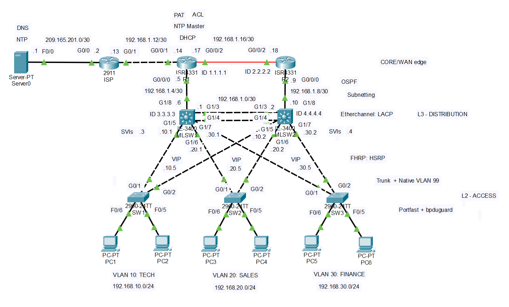

# CCNA-Megalab — Collapsed-Core Enterprise Network: Design, Implementation & Hardening

A complete enterprise-style network built in Cisco Packet Tracer (Version: 9.0.1.0858) after passing the CCNA: redundant collapsed-core architecture, dynamic routing, centralized network services, and layered security controls, with every configuration and verification command documented.

📖 **Full write-up with design rationale and the troubleshooting story:** [blog article — ◇ link]



## What This Project Demonstrates

- Design of a redundant collapsed-core enterprise topology (two multilayer switches folding core + distribution into one tier)
- L2/L3 implementation: VLANs, pruned trunks, LACP EtherChannel, PVST+, SVI-based inter-VLAN routing
- First-hop redundancy (HSRP) with deliberate HSRP/STP root alignment per VLAN
- Dynamic routing (OSPF Area 0) with loopback router IDs, passive interfaces, and equal-cost multipath toward the edge
- Centralized DHCP with relay, NAT/PAT with an eligibility ACL, DNS/NTP synchronization
- Access-layer hardening: DHCP Snooping, Dynamic ARP Inspection, Port Security, BPDU Guard, SSH-only management with ACL restrictions
- Methodical troubleshooting of a NAT misconfiguration masked by the lab environment — see [verification/nat.md](verification/nat.md)

## Architecture

| Device | Role |
|---|---|
| MLSW1 / MLSW2 | Layer 3 multilayer switches — inter-VLAN routing, HSRP, STP roots, LACP EtherChannel between them |
| SW1–SW3 | Layer 2 access switches, one user VLAN each |
| R1 | Edge router — centralized DHCP, NAT/PAT, internet boundary |
| R2 | Secondary exit path |
| ISP / Server0 | Simulated external network |

**Design highlights:**

- **HSRP and STP alignment** — active gateway and root bridge roles are assigned to the same device per VLAN, keeping L2 forwarding paths aligned with the first-hop gateway path.
- **Asymmetric redundancy by design** — MLSW1 has a direct routed path to R1; MLSW2 reaches the edge via R2, producing equal-cost routing from MLSW2 (verified in [verification/nat.md](verification/nat.md)).
- **Black-hole native VLAN 99** — no hosts, pruned trunks, stray untagged traffic goes nowhere productive.

| VLAN | Purpose | Subnet |
|---|---|---|
| 10 | Users 1 | 192.168.10.0/24 |
| 20 | Users 2 | 192.168.20.0/24 |
| 30 | Users 3 | 192.168.30.0/24 |
| 99 | Unused native | — |

Full addressing and VLAN assignment: [topology/ip-addressing-table.md](topology/ip-addressing-table.md)

## Repository Structure

```text
CCNA-Megalab/
├── README.md
├── topology/
│   ├── network-topology.png
│   └── ip-addressing-table.md
├── configurations/      # complete sanitized configs, one file per device
│   ├── MLSW1.txt  ├── MLSW2.txt
│   ├── SW1.txt    ├── SW2.txt    ├── SW3.txt
│   ├── R1.txt     ├── R2.txt     └── ISP.txt
└── verification/        # real captured output — evidence, not illustration
    ├── hsrp.md
    ├── ospf.md          # incl. ECMP evidence
    ├── nat.md           # the NAT incident: symptom, investigation, fix, post-fix proof
    ├── dhcp-snooping-and-dai.md
    └── connectivity-tests.md
```

## Validation Summary

| Technology | Implementation | Verification |
|---|---|---|
| VLANs / Trunking | Segmented users, pruned trunks, black-hole native | `show vlan brief`, `show interfaces trunk` |
| EtherChannel | LACP `mode active` | `show etherchannel summary` |
| STP | Aligned roots, PortFast + BPDU Guard on edge | `show spanning-tree` |
| HSRP | Virtual gateway .5, failover tested | `show standby brief` |
| OSPF | Area 0, passive user SVIs, ECMP toward edge | `show ip ospf neighbor`, `show ip route ospf` |
| DHCP | Centralized pools, relay, exclusions | `show ip dhcp binding` |
| NAT/PAT | Overload, all inside interfaces tagged | `show ip nat translations` / `statistics` |
| DHCP Snooping + DAI | Trusted uplinks only, binding-validated ARP | `show ip dhcp snooping binding`, `show ip arp inspection statistics` |
| Port Security | Sticky MAC, restrict mode | `show port-security interface` |
| Management | SSHv2 only, mgmt ACL, login blocking | `show access-lists MGMT-ACCESS` |

Each item is evidenced with real lab output in the [verification/](verification/) folder — captured from this lab, not illustrative screenshots.

## Key Lessons & Known Limitations

**The NAT incident:** with ECMP toward the edge, a single missing `ip nat inside` on R1's second inside-facing interface silently untranslated flows exiting via R2, while the lab ISP's static route to RFC 1918 space kept every connectivity test green. Connectivity tests prove packets flow; only translations prove NAT works. Full story with evidence: [verification/nat.md](verification/nat.md).

**Documented limitations:**

- Built in Cisco Packet Tracer (Version: 9.0.1.0858) — simulator constraints, not design choices, include:
  - Legacy Type 5 password hashing (modern platforms use stronger algorithms)
  - `passive-interface` declared explicitly (Port-channel can't be excluded from `passive-interface default`)
- Access switch management SVIs live in user VLANs — a lab simplification; production would use a dedicated management VLAN
- Syslog forwarding to a SIEM (Splunk) with detections for DHCP snooping violations, DAI drops, port-security events and SSH brute-force attempts is the planned next milestone
- All credentials have been removed from published configurations

## Related Work

This lab extends my security portfolio — see my other projects covering security investigations, Splunk log analysis, and blue-team certifications (BTL1, CCDL1, Security+): [Link to portfolio](https://citadelcybersec.netlify.app/) [Link to Medium](https://medium.com/@citadelcybersec)

---

*Feedback welcome — if you spot something I could do better, I'd genuinely like to hear it.*
