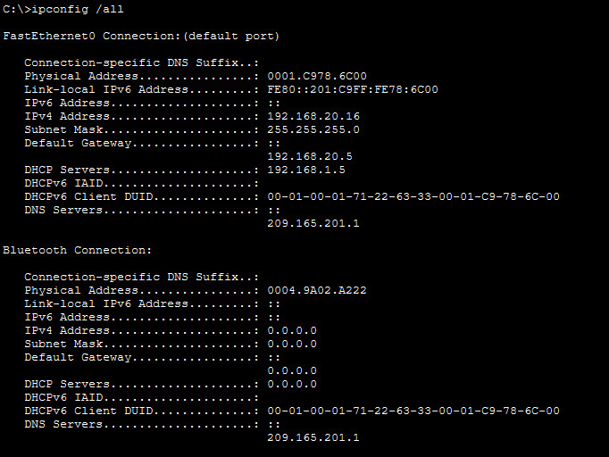

# Connectivity Tests — and Why They Were Not Enough

Related screenshots: 



## Addressing sanity (VLAN 20 client)

DHCP lease from R1 (relay via the MLS switches), default gateway is the HSRP virtual IP .5, DNS from the pool (the raw capture also contains the PC's unused Bluetooth adapter with zeroed addresses; omitted here):

```
C:\>ipconfig /all

FastEthernet0 Connection:(default port)

   Connection-specific DNS Suffix..:
   Physical Address................: 0001.C978.6C00
   Link-local IPv6 Address.........: FE80::201:C9FF:FE78:6C00
   IPv6 Address....................: ::
   IPv4 Address....................: 192.168.20.16
   Subnet Mask.....................: 255.255.255.0
   Default Gateway.................: ::
                                     192.168.20.5
   DHCP Servers....................: 192.168.1.5
   DHCPv6 IAID.....................:
   DHCPv6 Client DUID..............: 00-01-00-01-71-22-63-33-00-01-C9-78-6C-00
   DNS Servers.....................: ::
                                     209.165.201.1
```

Note the gateway: **192.168.20.5**. It is the HSRP virtual IP, not a physical switch.

## The green tests that hid the NAT bug

End-to-end connectivity tests passed from every VLAN — which is precisely why the missing `ip nat inside` on Gi0/0/2 survived unnoticed until translations were inspected (full story: `nat.md`). No raw outputs of those earliest green pings were preserved; the principle they demonstrate (passing pings over a partially broken path) is documented narratively and made concrete by the traceroute below, which shows a client flow on exactly the path that was broken.

## Path evidence: traceroute from PC3 (VLAN 20)

```
C:\>tracert 209.165.201.1

Tracing route to 209.165.201.1 over a maximum of 30 hops:

  1   0 ms      0 ms      0 ms      192.168.20.4
  2   0 ms      0 ms      0 ms      192.168.1.9
  3   0 ms      0 ms      0 ms      192.168.1.5
  4   *         *         *         Request timed out.
  5   4 ms      0 ms      0 ms      209.165.201.1

Trace complete.
```

Reading it: hop 1 answers as `192.168.20.4` — MLSW2 owns the VIP `.5` and replies to traceroute probes with its physical SVI address, normal behavior. **Hop 2 is `192.168.1.9` (R2)**: this flow took the ECMP branch via R2, entering R1 on Gi0/0/2 — the exact path whose missing `ip nat inside` caused the incident. Hop 3 is R1; hop 4 times out (the interface at that TTL position does not emit time-exceeded replies in this simulation); hop 5 is the destination answering. This single output bridges `ospf.md` (the ECMP routing table) to `nat.md` (the incident): the load-balancing design and the NAT fault meet on this path.

## Retest after both fixes (NAT tagged, ISP route removed)

Captured in the final state, `ip nat inside` on both of R1's inside interfaces, and the ISP's static route to `192.168.0.0/16` deleted (route table in `nat.md`). Connectivity from all three user VLANs:

**PC1, VLAN 10:**

```
C:\>ping 209.165.201.1

Pinging 209.165.201.1 with 32 bytes of data:

Reply from 209.165.201.1: bytes=32 time<1ms TTL=125
Reply from 209.165.201.1: bytes=32 time<1ms TTL=125
Reply from 209.165.201.1: bytes=32 time<1ms TTL=125
Reply from 209.165.201.1: bytes=32 time<1ms TTL=125

Ping statistics for 209.165.201.1:
    Packets: Sent = 4, Received = 4, Lost = 0 (0% loss),
Approximate round trip times in milli-seconds:
    Minimum = 0ms, Maximum = 0ms, Average = 0ms
```

**PC3, VLAN 20:**

```
C:\>ping 209.165.201.1

Pinging 209.165.201.1 with 32 bytes of data:

Request timed out.
Reply from 209.165.201.1: bytes=32 time<1ms TTL=125
Reply from 209.165.201.1: bytes=32 time<1ms TTL=125
Reply from 209.165.201.1: bytes=32 time<1ms TTL=125

Ping statistics for 209.165.201.1:
    Packets: Sent = 4, Received = 3, Lost = 1 (25% loss),
Approximate round trip times in milli-seconds:
    Minimum = 0ms, Maximum = 0ms, Average = 0ms
```

PC3's single lost packet was the first echo of the run — consistent with ARP/path setup on the first packet rather than a path fault: the subsequent three replies succeeded with identical TTL, the translation table in `nat.md` shows PC3's VLAN 20 flows translating normally, and the traceroute above from the same PC completes. Noted for transparency, not treated as a failure.

**PC5, VLAN 30:**

```
C:\>ping 209.165.201.1

Pinging 209.165.201.1 with 32 bytes of data:

Reply from 209.165.201.1: bytes=32 time<1ms TTL=125
Reply from 209.165.201.1: bytes=32 time<1ms TTL=125
Reply from 209.165.201.1: bytes=32 time<1ms TTL=125
Reply from 209.165.201.1: bytes=32 time<1ms TTL=125

Ping statistics for 209.165.201.1:
    Packets: Sent = 4, Received = 4, Lost = 0 (0% loss),
Approximate round trip times in milli-seconds:
    Minimum = 0ms, Maximum = 0ms, Average = 0ms
```

All replies arrive with TTL 125: outbound translations succeed and unsolicited inbound from the ISP fails (`ISP#ping 192.168.10.15`, in `nat.md`), exactly the intended boundary: private hosts work outward, and are invisible from outside.

## Takeaway

A passing connectivity test proves packets flow — nothing more. In this lab, the green tests persisted across a real configuration fault because the test environment supplied routing behavior no ISP would. The evidentiary standards this project settled on: for NAT it is translation state, for routing it is the routing table, for redundancy it is a forced failure, and for paths it is a traceroute.
